# Toulouse Way – process automation

A no-server platform built on **n8n**, **Google Sheets** and **Gmail** that automates the two daily processes of the Toulouse Way association:

1. **Networking introductions** – connecting international job seekers with members of the association's professional network.
2. **Trainings and events** – public calendar, registrations, reminders with attendance confirmation, cancellations.

Everything is managed from a responsive, branded **management space**, including a dashboard and an editor for every email the platform sends.

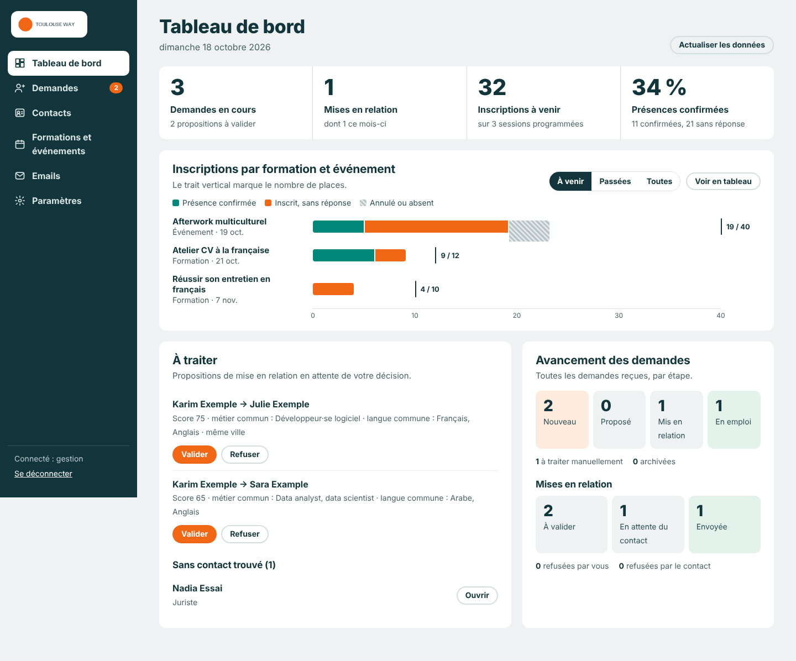

---

## Contents

- [The association](#the-association)
- [The need](#the-need)
- [The solution](#the-solution)
- [Screenshots](#screenshots)
- [Repository layout](#repository-layout)
- [Quick start](#quick-start)
- [Documentation](#documentation)

---

## The association

**Toulouse Way** is a non-profit association (French *loi 1901*, recognised as being of general interest) founded in Toulouse in May 2023. Its mission is to **facilitate the professional integration of international talent in Toulouse** by opening networks and building human bridges between newcomers and local residents and companies. Its motto is *« Mieux vivre ici, ensemble »* ("living better here, together") and its conviction is that *everyone can be a link in someone else's network*.

The association points out that around half of hires happen through the hidden job market, and that rebuilding an equivalent professional network after moving can take years. Newcomers – often highly qualified – therefore lack the contacts that matter most.

**Main activities**

| Activity | What it is |
| --- | --- |
| Professional network meetings (*Permanences Réseaux Pro*) | Free monthly meetings bringing newcomers and members together |
| Network mentoring (*Parrainage réseau*) | Free micro-mentoring pairing a Toulouse professional with a newcomer |
| *Cultures Are The Way* | Annual multicultural event (career workshops, performances, networking), about 300 participants per edition |
| *Toulouse en Jeu* | A 131-card game about Toulouse culture, supported by the City of Toulouse and the JCE |
| Social, sports and cultural programme | Activities organised by the members themselves |

The association has more than 50 active members and works with institutional and corporate partners such as the City of Toulouse, the Occitanie Region and local companies.

*Sources: [toulouseway.org](https://www.toulouseway.org/), [HelloAsso page](https://www.helloasso.com/associations/toulouse-way), [JeVeuxAider.gouv.fr](https://www.jeveuxaider.gouv.fr/organisations/34133-toulouse-way). Figures are those published by the association.*

---

## The need

The association runs on volunteers. Before this project, introductions and registrations were handled by hand in spreadsheets and individual emails. The request was to automate them, in two phases.

**Phase 1 – first automation**

- Match job seekers with the association's contacts, with a coordinator validating each introduction.
- Send reminder emails to people registered for trainings.

**Phase 2 – a complete management tool**

| # | Requirement |
| --- | --- |
| N1 | A **public request form**: contact details, **languages spoken** (multiple choice) and **target jobs** (multiple choice). |
| N2 | Emails to job seekers written **in the languages they selected**. |
| N3 | The **visual identity** of the association on forms, pages and emails. |
| N4 | A **public calendar** where anyone can register for a training or an event; the registration is saved in the base and **the manager is notified**. |
| N5 | A **confirmation email** to the participant. |
| N6 | Reminders **3 days and 1 day before**, asking the person to **confirm or cancel** their attendance. |
| N7 | **The manager is notified when someone cancels.** |
| N8 | **Email templates editable** by the manager. |
| N9 | A **dashboard**: registrations per training/event, requests and their progress. |
| N10 | For each contact, a field saying whether they **agreed to share their details without being asked first**; if not, the contact receives an email presenting the job seeker and **accepts or refuses**. |
| N11 | A pleasant, **responsive** interface in the association's colours to **fully manage** contacts, trainings and events. |

---

## The solution

Seven n8n workflows serve the pages, process the forms and send every email. A Google Sheet is the database, and Gmail sends the messages. No other hosting is needed.

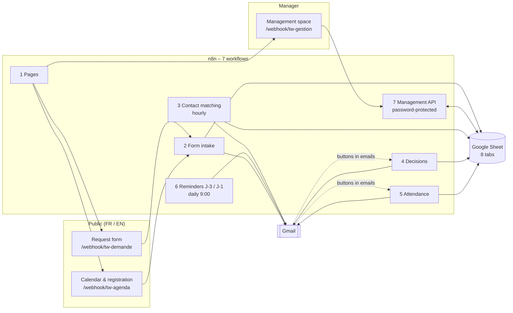

| Need | How it is met |
| --- | --- |
| N1 | Bilingual request form with searchable multi-select lists (16 languages, 30 jobs in 8 sectors, editable in the settings) |
| N2 | One email with **one section per selected language** (12 languages translated, right-to-left layout for Arabic and Persian; French fallback) |
| N3 | Colours, logo, slogan and footer stored in the *Parametres* tab and applied to every page and email |
| N4, N5 | Public calendar with remaining seats, registration dialog, duplicate and capacity checks, confirmation email, manager notification |
| N6, N7 | Daily job sends J-3 and J-1 reminders with **"I'll be there" / "I can't make it"** buttons; a cancellation frees the seat and notifies the manager |
| N8 | Email editor: every template, every language, live preview, variables and buttons inserted in one click |
| N9 | Dashboard: KPIs, registrations per session (confirmed / no answer / cancelled vs seats), proposals to validate, progress of requests |
| N10 | `accord_partage` field per contact; without consent, the contact gets an Accept / Refuse email before anything is shared |
| N11 | Management space for requests, contacts, sessions, registrants, emails and settings; tested at 7 screen widths from 320 to 1280 px |

**Introduction flow**

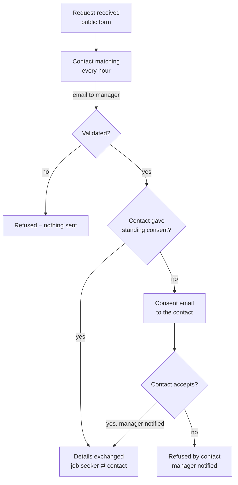

**Matching score**: at least one target job in common is required (+50, then +15 per extra job, max +30). A shared language adds +15 and the same city +10. Each previous introduction of the contact removes 2 points (max −10) to spread the requests. The minimum score and the number of proposals are settings.

---

## Screenshots

The screenshots show the real pages of the application with **fictitious demo data**. They use a placeholder logo; in production the association's logo is loaded from its website. The public pages exist in French and English, and the management space is in French.

| | |
| --- | --- |
| 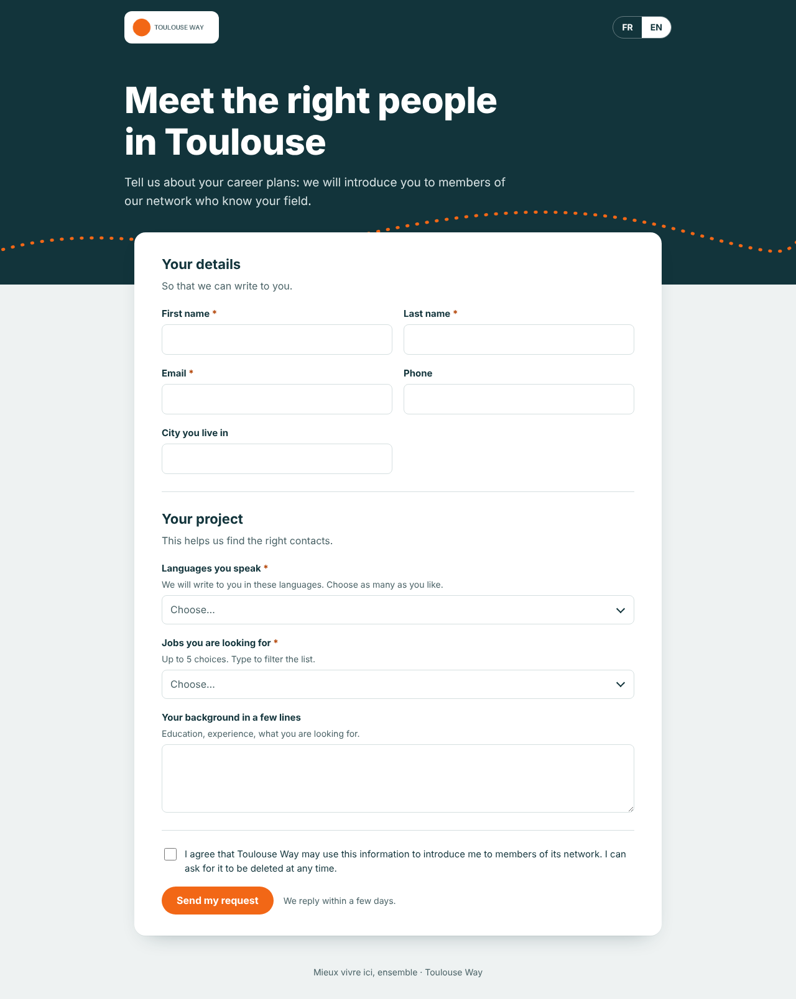 Request form | 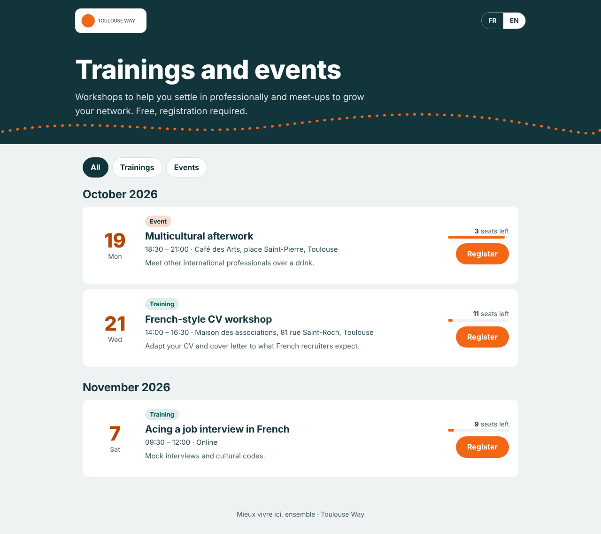 Public calendar |
| 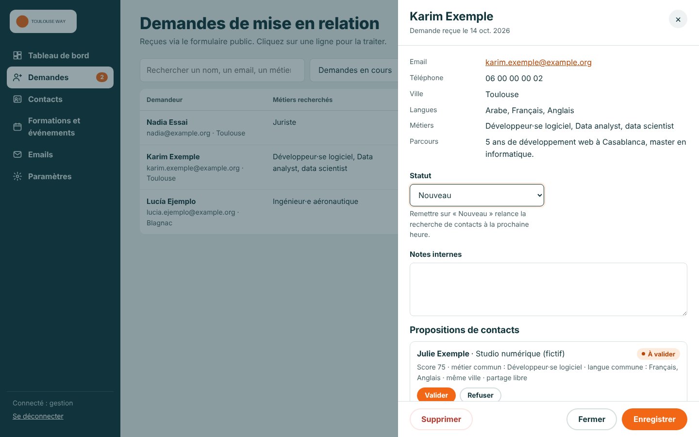 Request with contact proposals | 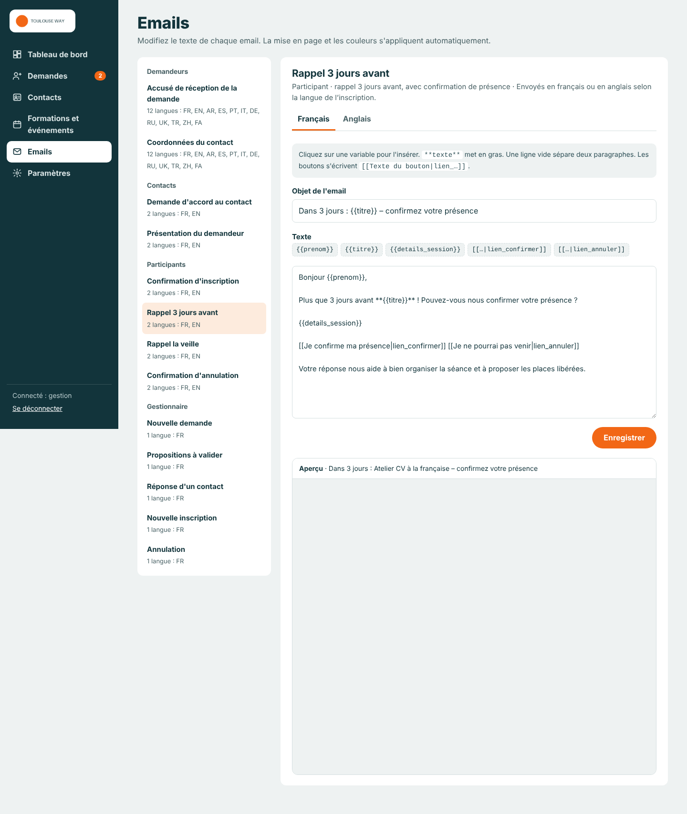 Email editor with live preview |
| 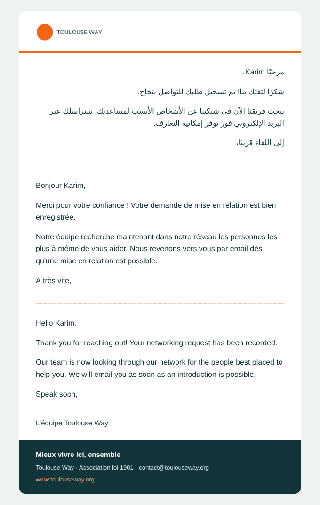 Acknowledgement in Arabic, French and English | 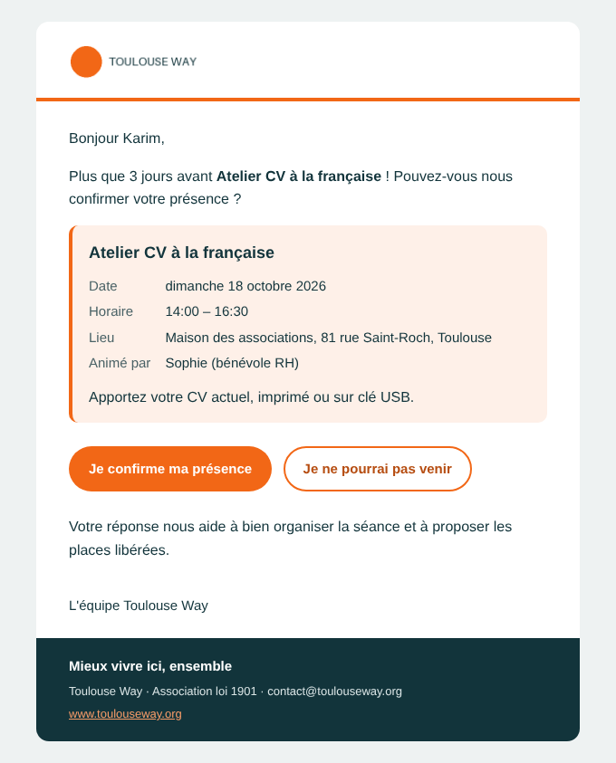 J-3 reminder with attendance buttons |

| Mobile | | | |
| --- | --- | --- | --- |
| 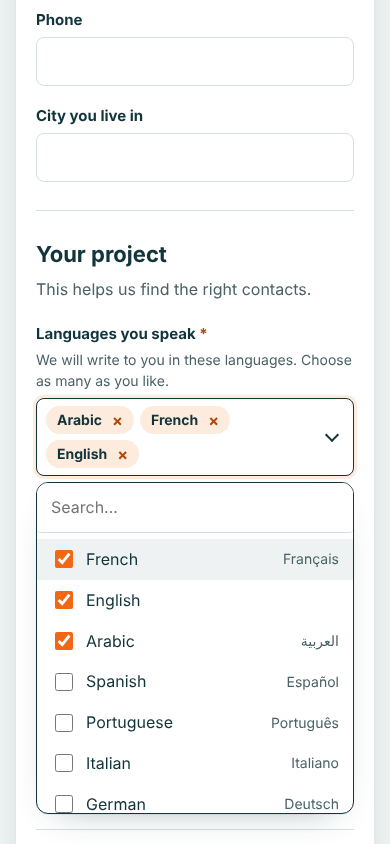 | 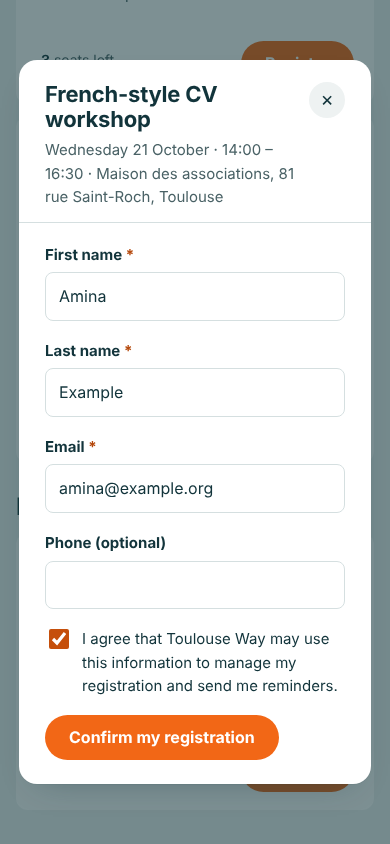 | 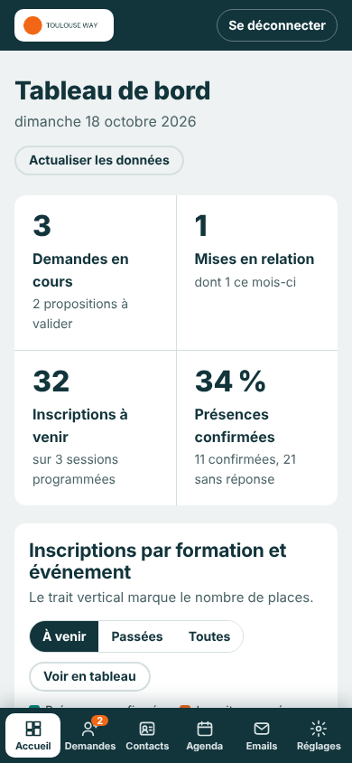 | 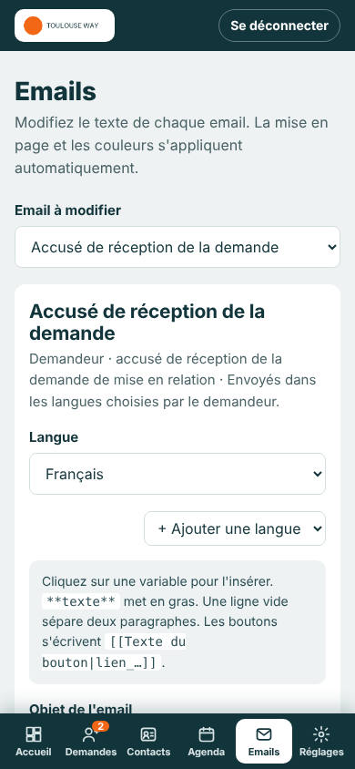 |

Every screen and every email is shown step by step in the **[user stories tutorial](docs/user-stories.md)**.

---

## Repository layout

```
toulouse-way-automation/
├── workflows/          # The 7 n8n workflows, ready to import (generated)
├── template/           # Toulouse_Way_base.xlsx – the Google Sheet to import (generated)
├── src/
│   ├── lib.js          # Shared library: templates, multilingual emails, dates, pages
│   ├── nodes/          # Code of every n8n Code node
│   └── pages/          # Request form, calendar, management space (HTML/CSS/JS)
├── seed/seed.js        # Settings, lists, the 41 email templates and example rows
├── tools/              # Build, tests, demo data, screenshots
└── docs/               # Tutorial, setup, architecture, images
```

The files in `workflows/` and `template/` are **generated** from `src/` and `seed/`. Edit the sources, then rebuild.

---

## Quick start

```bash
npm run build          # Sheet template + 7 workflows (Sheet ID placeholder)
npm test               # 343 logic checks on every Code node
TW_SHEET_ID=<your-sheet-id> npm run build:workflows   # workflows bound to your Sheet
```

Then follow **[docs/setup.md](docs/setup.md)**:

1. Import the template into Google Sheets.
2. Create 3 n8n credentials (Google Sheets, Gmail, management password).
3. Import and publish the 7 workflows.
4. Fill in the *Parametres* tab.

---

## Documentation

| Document | Content |
| --- | --- |
| [docs/user-stories.md](docs/user-stories.md) | **Tutorial**: every user story, step by step, with screenshots |
| [docs/setup.md](docs/setup.md) | Installation and configuration in n8n and Google |
| [docs/architecture.md](docs/architecture.md) | Workflows, data model, statuses, email templates, security |
| [docs/troubleshooting.md](docs/troubleshooting.md) | Common errors and their fixes |

---

*Built for Toulouse Way. Contact the association: contact@toulouseway.org.*
