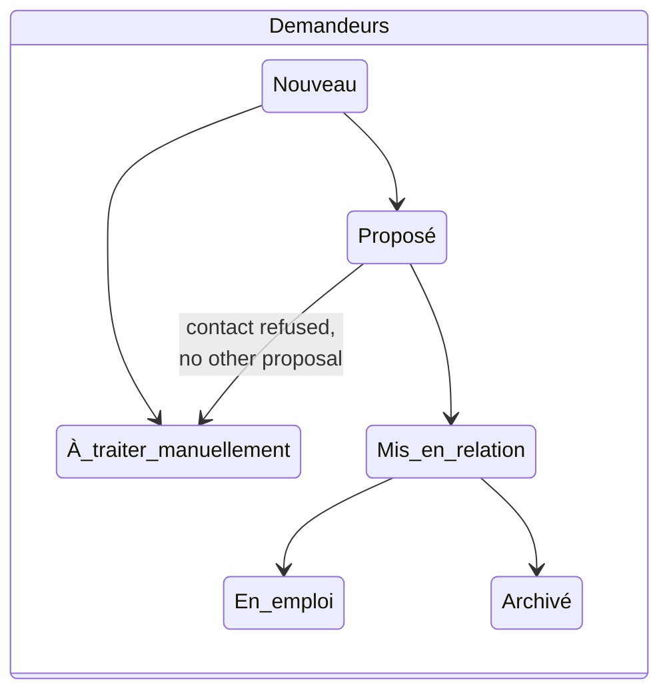

# Architecture

## Components

| Component | Role |
| --- | --- |
| **n8n** (7 workflows) | Serves the pages, receives the forms, matches contacts, handles the clicks in emails, sends reminders, exposes the management API |
| **Google Sheets** (1 file, 8 tabs) | Database, readable and editable by hand if needed |
| **Gmail** | Sends every email from the association's account |
| **Pages** (`src/pages`) | Self-contained HTML/CSS/JS pages, generated and served by workflow 1, with the visual identity read from the `Parametres` tab |

No other server, database or hosting is involved.

## Workflows

| # | File | Trigger | Main steps |
| --- | --- | --- | --- |
| 1 | `1_pages.json` | GET `tw-demande`, `tw-agenda`, `tw-gestion` | Reads settings, lists and sessions, then returns the page with its data embedded. The calendar only exposes published, future sessions and remaining seats. |
| 2 | `2_formulaires.json` | POST `tw-demande-envoi`, `tw-inscription-envoi` | Validates the data, appends the row, answers the page, then sends the acknowledgement (in the requester's languages) or the confirmation, plus the manager notification. |
| 3 | `3_matching.json` | Every hour | Scores the available contacts for each **Nouveau** request, saves up to N proposals **À valider**, updates the request status and emails the manager. |
| 4 | `4_decisions.json` | GET `tw-decision?t=…&a=…` | Manager validate/refuse; contact accept/refuse. Exchanges the contact details, or sends the consent email, updates the three tabs and notifies the manager. |
| 5 | `5_presence.json` | GET `tw-presence?t=…&a=…` | Participant confirm/cancel. Updates the status; on cancellation, sends the confirmation and notifies the manager. |
| 6 | `6_rappels.json` | Every day at 9:00 (Europe/Paris) | Sends J-3 and J-1 reminders to active registrants and timestamps `rappel_J3` / `rappel_J1`. |
| 7 | `7_api.json` | POST `tw-api` (Header Auth `X-TW-Auth`) | `load` returns every tab; `save` creates or updates a row by `id` in any tab; `delete` deletes a row by `id`. |

## Data model

| Tab | Columns | Filled by |
| --- | --- | --- |
| `Parametres` | id, valeur, description | Management space → Settings |
| `Listes` | id, type (`langue`/`metier`), code, libelle_fr, libelle_en, libelle_natif, groupe, ordre | Settings |
| `Templates` | id (`cle\|langue`), cle, langue, description, sujet, contenu | Emails editor |
| `Sessions` | id, type, titre, titre_en, description, description_en, date, heure_debut, heure_fin, lieu, lien_visio, places, intervenant, infos_pratiques, publie | Trainings and events screen |
| `Inscriptions` | id, session_id, prenom, nom, email, telephone, langue, date_inscription, statut, token, rappel_J3, rappel_J1, date_reponse | Calendar form, workflows 5–6, management space |
| `Demandeurs` | id, date_demande, prenom, nom, email, telephone, ville, langues, metiers, parcours, statut, contacts_proposes, date_mise_en_relation, notes | Request form, workflows 3–4, management space |
| `Contacts` | id, prenom, nom, email, telephone, entreprise, poste, ville, langues, metiers, langue_contact, **accord_partage**, disponible, nb_mises_en_relation, derniere_mise_en_relation, notes | Contacts screen, workflow 4 |
| `MisesEnRelation` | id, date, token, token_contact, statut, score, raisons, demandeur_id, demandeur_nom, contact_id, contact_nom, date_decision, historique | Workflows 3–4 only |

`langues` and `metiers` hold comma-separated codes from the `Listes` tab (e.g. `ar,fr,en`).

### Statuses

| Tab | Statuses |
| --- | --- |
| Demandeurs | Nouveau → Proposé / À traiter manuellement → Mis en relation → En emploi / Archivé |
| MisesEnRelation | À valider → En attente du contact → Envoyée, or Refusée / Refusée par le contact |
| Inscriptions | Inscrit → Confirmé / Annulé → Présent / Absent |

## Email templates

13 emails, 41 language versions, all editable in the management space.

| Key | Recipient | Languages |
| --- | --- | --- |
| `demande_recue` | Job seeker | 12: fr, en, ar, es, pt, it, de, ru, uk, tr, zh, fa |
| `mise_en_relation_demandeur` | Job seeker | Same 12 |
| `mise_en_relation_contact` | Contact | fr, en |
| `accord_contact` | Contact | fr, en |
| `inscription_confirmee`, `rappel_j3`, `rappel_j1`, `annulation_participant` | Participant | fr, en |
| `gestionnaire_nouvelle_demande`, `gestionnaire_propositions`, `gestionnaire_reponse_contact`, `gestionnaire_nouvelle_inscription`, `gestionnaire_annulation` | Manager | fr |

**Language rules**

- **Job seeker**: one email with one section per language they selected, in the order chosen. Languages without a translation fall back to French.
- **Contact**: their `langue_contact` (fr or en).
- **Participant**: the language of the calendar page they registered from.

Templates use `{{variable}}`, `**bold**`, `[[Button label|lien_x]]` and auto-formatted boxes (`{{details_session}}`, `{{details_contact}}`, `{{details_demandeur}}`, `{{liste_propositions}}`). Rendering is in `src/lib.js` (`TW.email`). Every value is HTML-escaped.

## Security and privacy

- **Management data** is only reachable through workflow 7, protected by the `X-TW-Auth` header (`username:password`). The public pages contain no contact or registrant data, and the video link of a session is only sent to its registrants.
- **Links in emails** carry a random 32-character token, specific to each proposal or registration. Clicking twice has no extra effect, and past sessions refuse changes.
- **Input validation**: lengths are capped, emails are checked, language and job codes are checked against the lists, and duplicates and capacity are checked for registrations. The API only writes known columns of known tabs.
- **Consent**: both public forms require an explicit consent checkbox. Contacts without standing consent decide case by case.
- **Data retention (GDPR)**: share the Google Sheet only with the people who need it, and delete or archive inactive requests regularly, e.g. after 2 years. Requests can be deleted from the management space.

## Code organisation

| Path | Content |
| --- | --- |
| `src/lib.js` | Shared library `TW`: settings, dates (Europe/Paris), template rendering, multilingual emails, information boxes, response pages |
| `src/nodes/*.js` | Body of each Code node (page building, validation, matching, decisions, attendance, reminders, API) |
| `src/pages/` | `demande.html`, `agenda.html`, `admin.html`, plus the shared `base.css` and the accessible multi-select `ms.js` |
| `tools/build-workflows.js` | Assembles the 7 n8n JSON files and inlines the library and pages into the nodes |
| `tools/test.js` | Runs every Code node against fixtures: 343 checks covering validation, matching, consent flow, reminders, API and workflow structure |
| `tools/screenshots.py` | Playwright screenshots of the real pages with fictitious demo data |
