# Tutorial – user stories

This tutorial walks through the application **one user story at a time**, with the screens and emails each person actually sees. All names and data in the screenshots are fictitious.

**Who uses the platform**

| Persona | Who | Uses |
| --- | --- | --- |
| **Job seeker** | International professional newly arrived in Toulouse | Public request form, emails |
| **Participant** | Anyone attending a training or an event | Public calendar, emails |
| **Network contact** | Member of the association's professional network | Emails only |
| **Manager** | Volunteer or staff member running the association | Management space, notification emails |

**Contents**

1. [Job seeker – ask for an introduction](#1-job-seeker--ask-for-an-introduction)
2. [Manager – validate the proposed contacts](#2-manager--validate-the-proposed-contacts)
3. [Network contact – consent before sharing my details](#3-network-contact--consent-before-sharing-my-details)
4. [Job seeker and contact – receive the introduction](#4-job-seeker-and-contact--receive-the-introduction)
5. [Participant – register for a training or an event](#5-participant--register-for-a-training-or-an-event)
6. [Participant – confirm or cancel from the reminders](#6-participant--confirm-or-cancel-from-the-reminders)
7. [Manager – follow activity on the dashboard](#7-manager--follow-activity-on-the-dashboard)
8. [Manager – handle requests](#8-manager--handle-requests)
9. [Manager – manage network contacts](#9-manager--manage-network-contacts)
10. [Manager – manage trainings, events and registrants](#10-manager--manage-trainings-events-and-registrants)
11. [Manager – edit the emails](#11-manager--edit-the-emails)
12. [Manager – settings, branding and lists](#12-manager--settings-branding-and-lists)
13. [Everyone – use it on a phone](#13-everyone--use-it-on-a-phone)

---

## 1. Job seeker – ask for an introduction

> **As a** job seeker, **I want to** describe my career plans, the languages I speak and the jobs I'm looking for, **so that** the association introduces me to people in my field, and writes to me in languages I understand.

**Steps**

1. Open the request form: `https://<your-n8n>/webhook/tw-demande` (French) or `…/tw-demande?lang=en` (English).
2. Fill in your contact details.
3. In **Languages you speak**, open the list, type to filter, and tick every language you speak. Each choice appears as a removable chip.
4. In **Jobs you are looking for**, choose up to 5 jobs. They are grouped by sector, and you can type to filter.
5. Optionally describe your background, tick the consent box, then click **Send my request**.

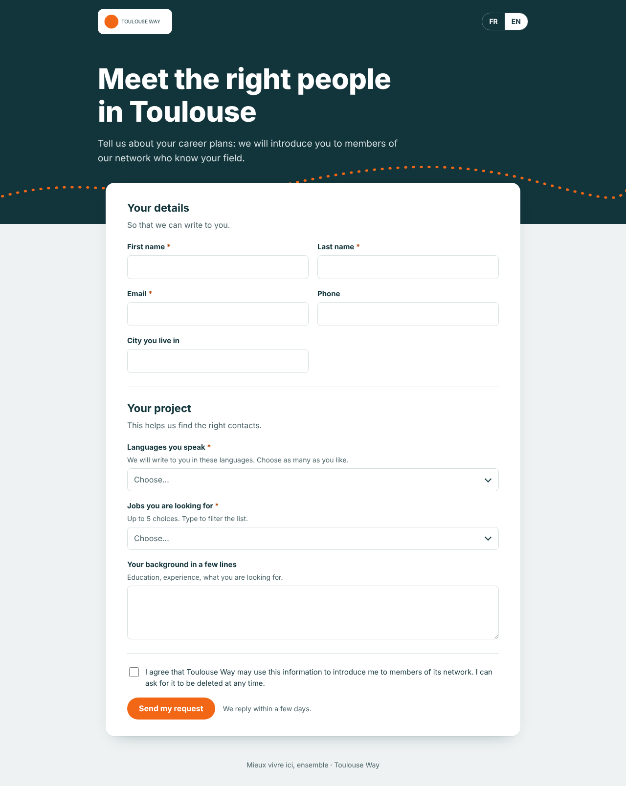

| Choosing languages | Choosing jobs | Request sent |
| --- | --- | --- |
| 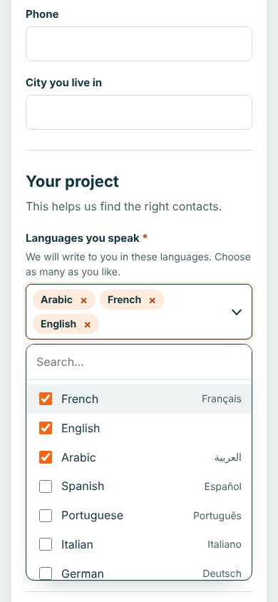 | 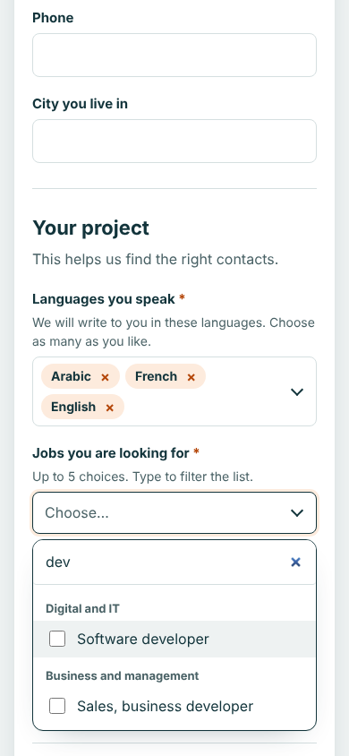 | 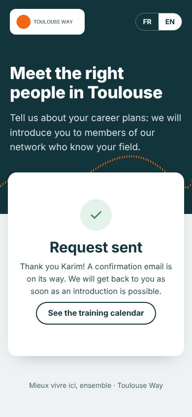 |

**What happens next**

- The request is saved in the *Demandeurs* tab with the status **Nouveau**.
- The job seeker receives an acknowledgement **with one section per language they selected**. Arabic and Persian are laid out right to left.
- The manager receives a notification.

| Acknowledgement (Arabic, French, English) | Manager notification |
| --- | --- |
| 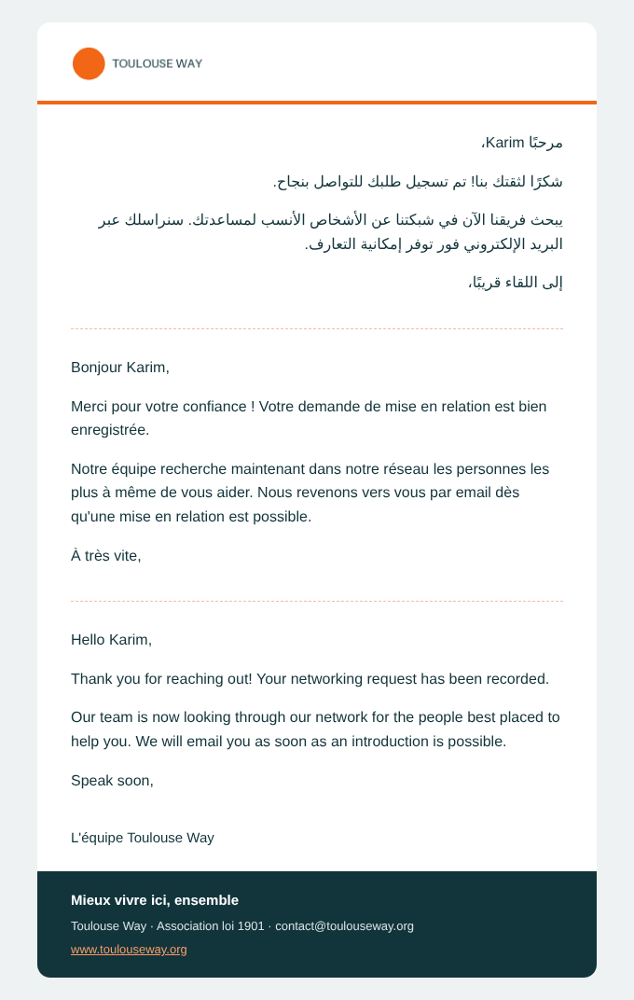 | 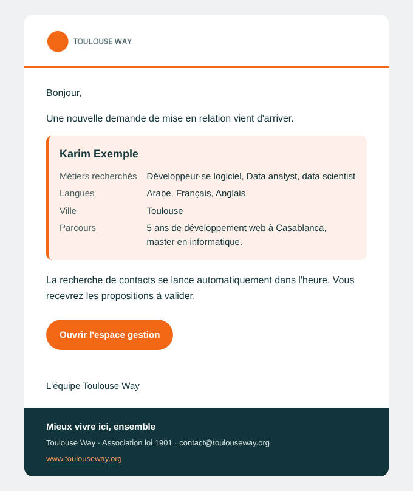 |

Required fields, a valid email address, at least one language, at least one job and the consent box are all checked before sending. Errors are shown next to each field.

---

## 2. Manager – validate the proposed contacts

> **As a** manager, **I want** the platform to propose the most relevant contacts for each new request, **so that** I only have to validate or refuse.

**How contacts are proposed (every hour)**

| Criterion | Points |
| --- | --- |
| At least one target job in common (required) | +50, then +15 per extra job (max +30) |
| At least one language in common | +15 |
| Same city | +10 |
| Each introduction the contact has already made | −2 (max −10) |

Only available contacts scoring at least the minimum score (50 by default) are proposed, up to 3 per request. A contact is never proposed twice to the same person.

**Steps**

1. You receive the email **"N mise(s) en relation à valider"**. For each request it shows the proposed contacts, the score, the reasons and whether the contact has given standing consent.
2. Click **Valider** or **Refuser** directly in the email, or do it from the management space (story 8).

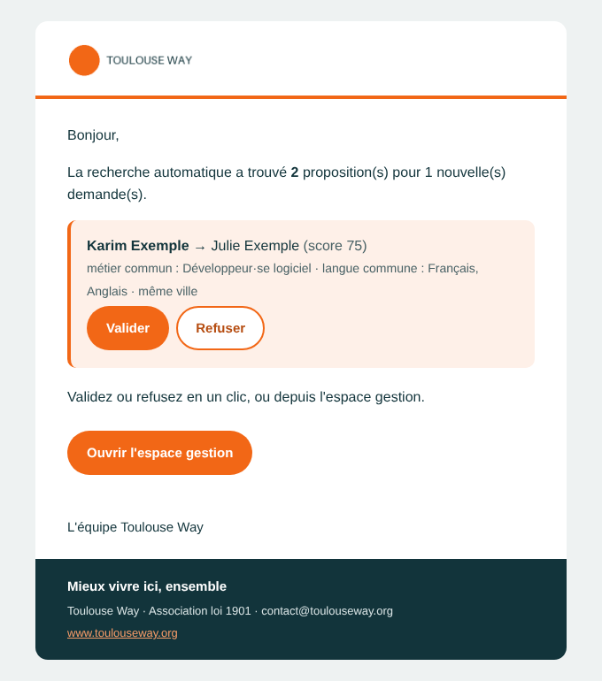

| After clicking Valider |
| --- |
| 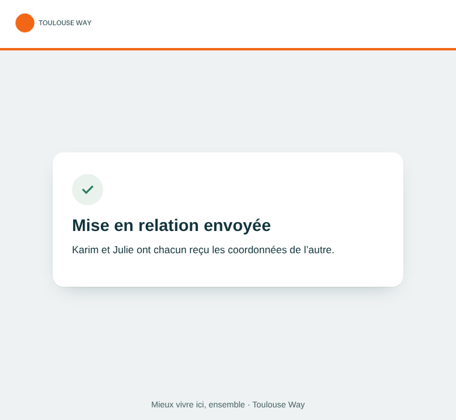 |

If no contact matches, the request becomes **À traiter manuellement** and is listed on the dashboard.

---

## 3. Network contact – consent before sharing my details

> **As a** network contact who has **not** given standing consent, **I want to** be asked before my details are shared, **so that** I stay in control of who contacts me.

Each contact has a setting **"Accord pour partager ses coordonnées sans le consulter"** (standing consent to share details), shown in story 9.

- **Consent given**: the details are exchanged as soon as the manager validates (story 4).
- **No standing consent**: after validation, the contact receives an email presenting the job seeker, *without* the job seeker's contact details, with two buttons.

**Steps**

1. Read the presentation of the job seeker.
2. Click **J'accepte de partager mes coordonnées** or **Je préfère refuser**.

| Consent request | After accepting |
| --- | --- |
| 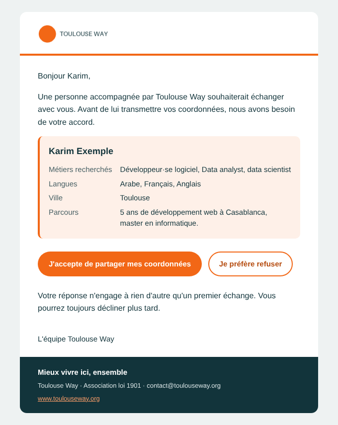 | 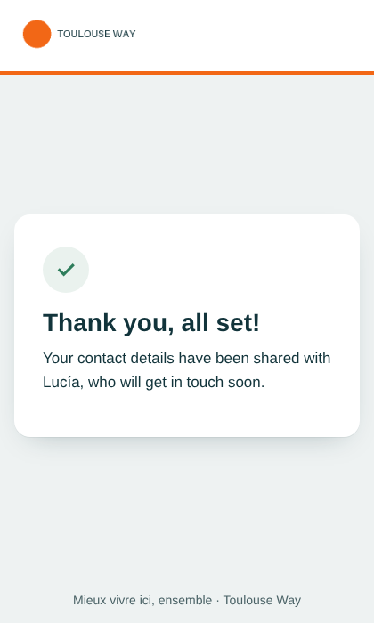 |

**What happens next**

- **Accept**: the details are exchanged (story 4) and the manager is notified.
- **Refuse**: nothing is shared and the manager is notified. If no other proposal is pending, the request goes back to **À traiter manuellement**.

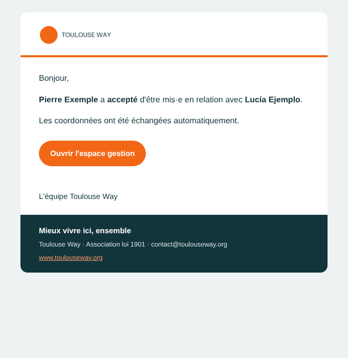

The contact's emails are in French or English, depending on the contact's preferred language.

---

## 4. Job seeker and contact – receive the introduction

> **As a** job seeker, **I want to** receive my contact's details in my languages; **as a** contact, **I want** a short presentation of the person who will get in touch.

| Job seeker – contact details, in each selected language | Contact – presentation of the job seeker |
| --- | --- |
| 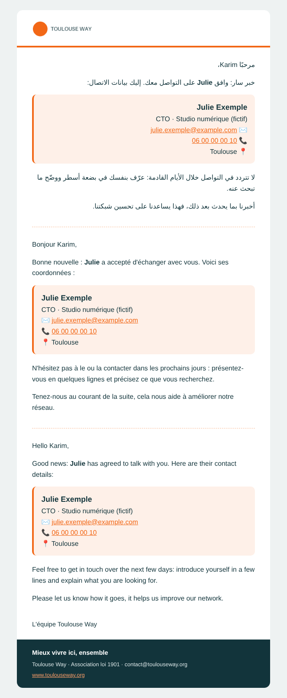 | 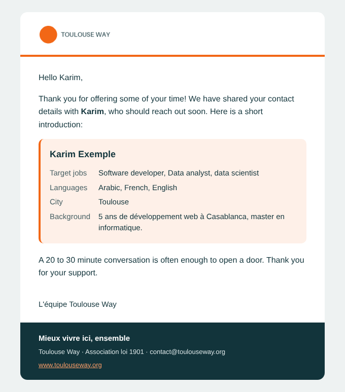 |

The request becomes **Mis en relation**. The proposal becomes **Envoyée**, and the contact's introduction counter goes up by one.

---

## 5. Participant – register for a training or an event

> **As a** visitor, **I want to** see the upcoming trainings and events and register in a few clicks, **so that** I get a confirmed seat.

**Steps**

1. Open the calendar: `https://<your-n8n>/webhook/tw-agenda` (add `?lang=en` for English). You can filter by trainings or events; remaining seats are shown.
2. Click **Register**, fill in your name and email, tick the consent box and confirm.

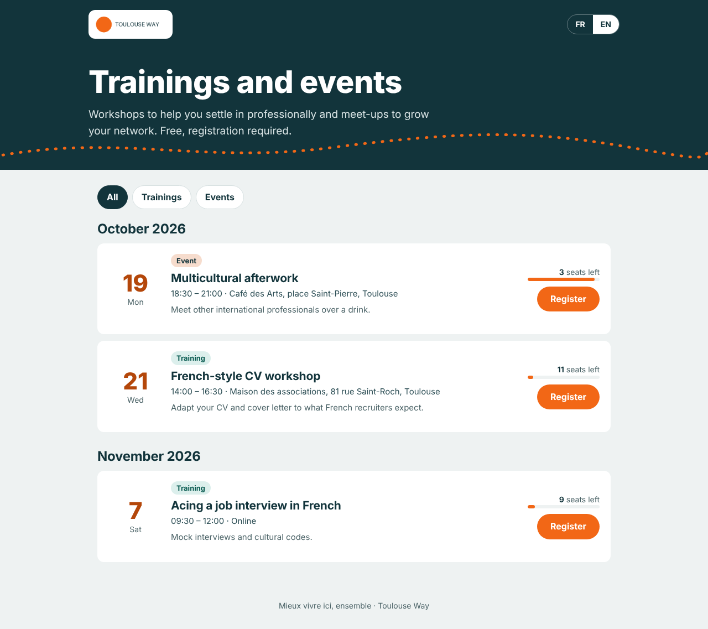

| Registration form | Registered |
| --- | --- |
| 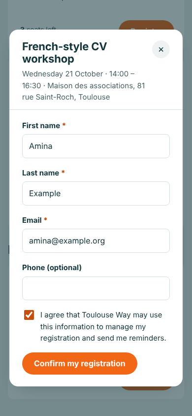 | 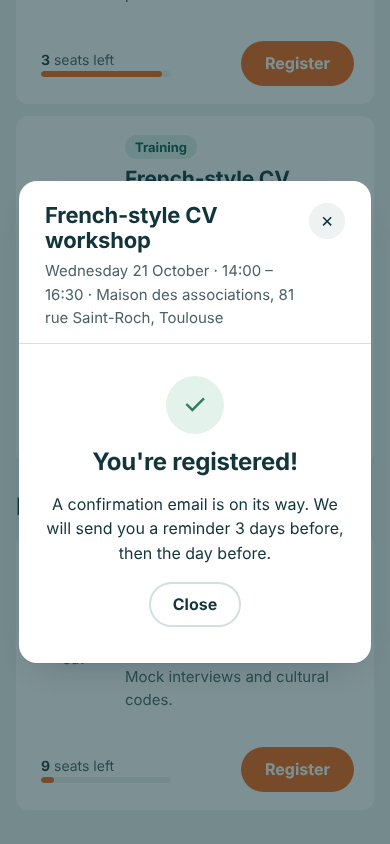 |

**What happens next**

- The registration is saved in the *Inscriptions* tab, with the status **Inscrit**.
- The participant receives a confirmation, in English or French depending on the page language. It includes a button to free the seat.
- The manager is notified, with the current number of registrants.

| Participant confirmation | Manager notification |
| --- | --- |
| 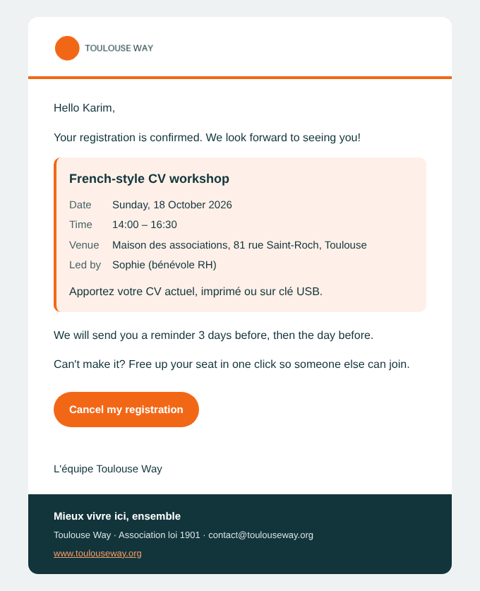 | 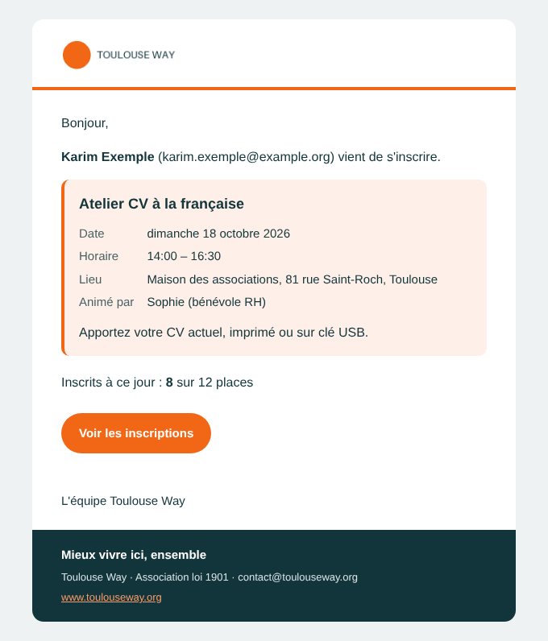 |

The same email cannot register twice for one session, and registration closes automatically when the session is full. Each session also has a direct registration link, shared from its page in the management space.

---

## 6. Participant – confirm or cancel from the reminders

> **As a** participant, **I want** a reminder before the session and an easy way to say whether I'm coming; **as a** manager, **I want to** know who cancels.

**Steps**

1. **3 days before** and **the day before**, at 9:00, the participant receives a reminder with the practical details.
2. They click **Je confirme ma présence** (*Yes, I'll be there*) or **Je ne pourrai pas venir** (*I can't make it*).

| Reminder 3 days before | Reminder the day before |
| --- | --- |
| 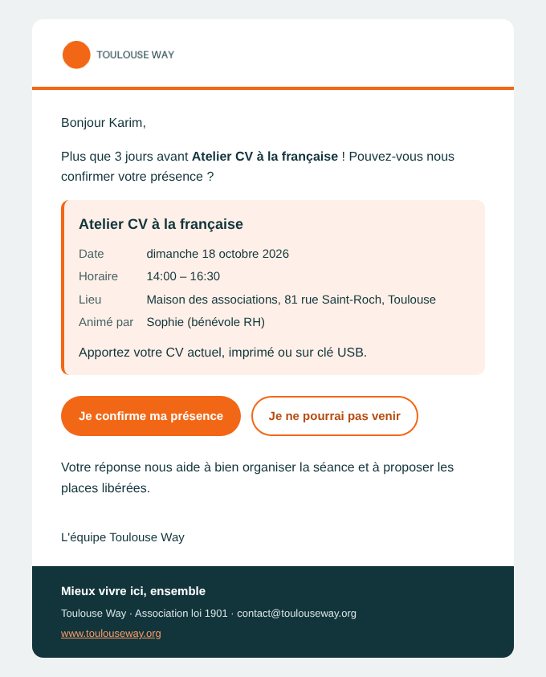 | 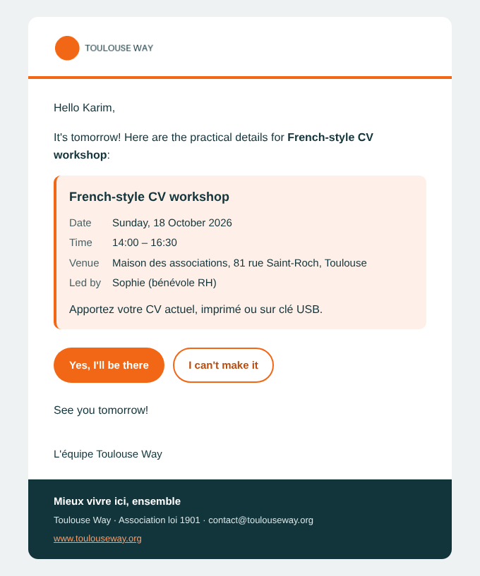 |

| Attendance confirmed | Cancellation recorded |
| --- | --- |
| 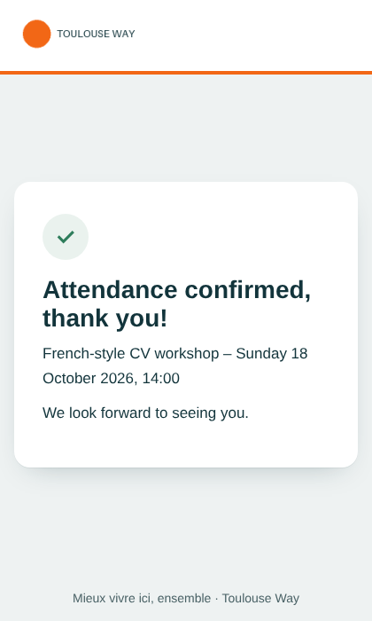 | 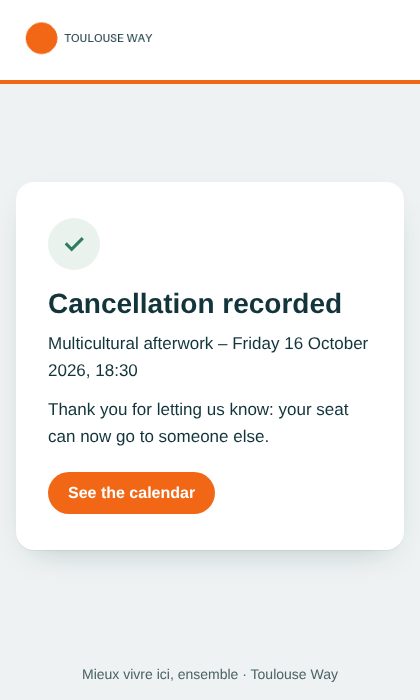 |

**What happens next**

- **Confirm**: the status becomes **Confirmé**.
- **Cancel**: the status becomes **Annulé** and the seat is freed in the calendar. The participant receives a confirmation and the manager is notified, with the moment of the cancellation and the remaining number of registrants.

| Participant | Manager |
| --- | --- |
| 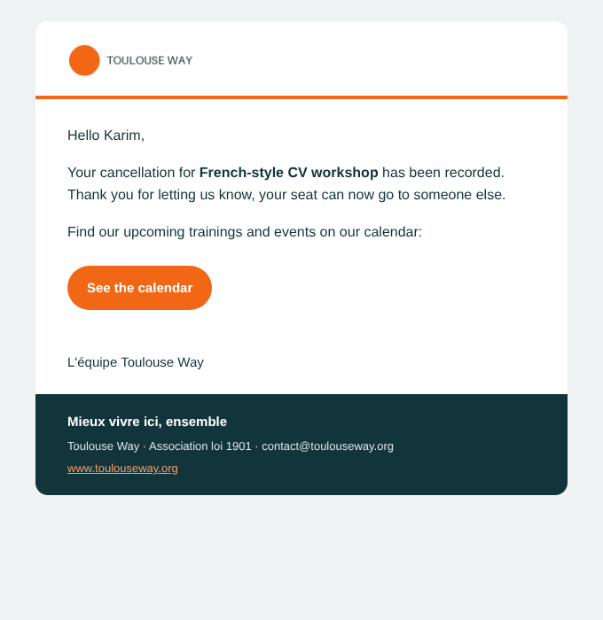 | 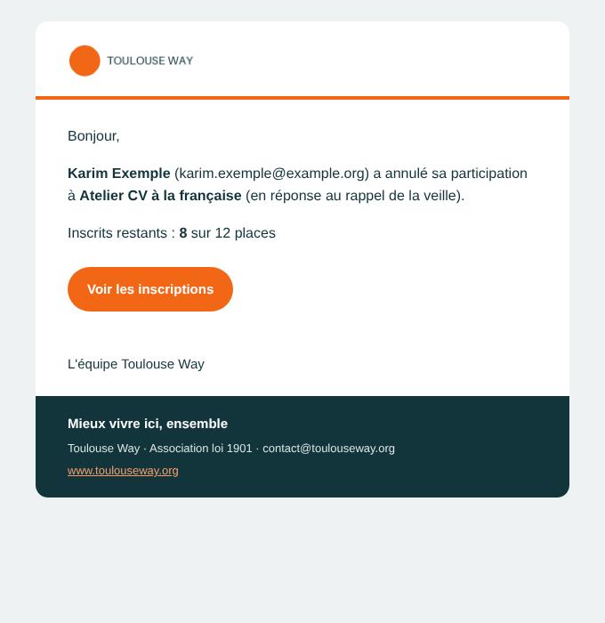 |

Each reminder is sent only once (the sending date is recorded), and cancelled registrations receive none.

---

## 7. Manager – follow activity on the dashboard

> **As a** manager, **I want** an overview of requests and registrations, **so that** I know what needs my attention.

**Steps**

1. Open `https://<your-n8n>/webhook/tw-gestion` and sign in with the association's username and password.
2. The dashboard opens.

| Sign in | |
| --- | --- |
| 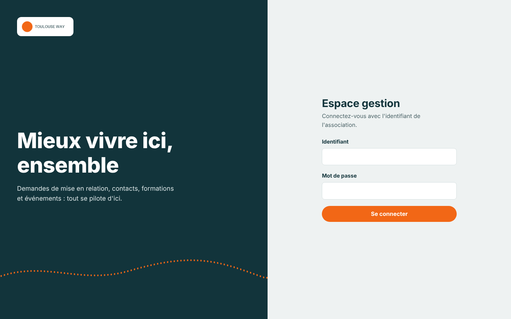 | |

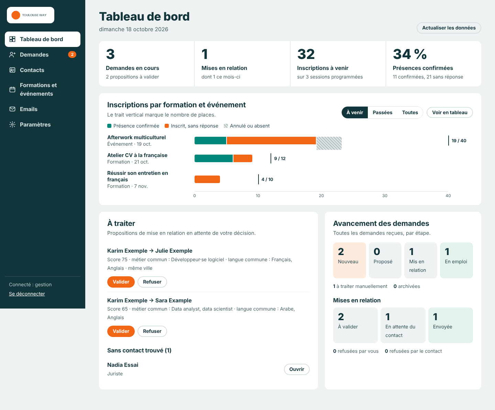

**What it shows**

- **Key figures**: requests in progress, introductions made (and this month), upcoming registrations, share of confirmed attendance.
- **Registrations per training and event**: confirmed, no answer and cancelled/absent, compared with the number of seats (the vertical line). Filter by upcoming, past or all; hover a bar for the detail, or switch to a table view.
- **To handle**: proposals waiting for validation (Valider / Refuser) and requests with no contact found.
- **Progress of requests**: how many requests are at each stage, and the status of introductions.

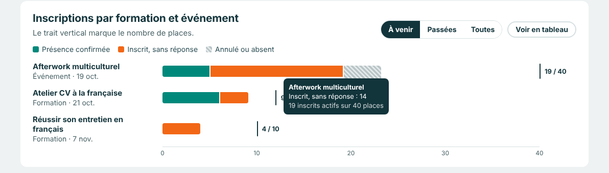

---

## 8. Manager – handle requests

> **As a** manager, **I want to** see every request and act on it, **so that** nobody is forgotten.

**Steps**

1. Open **Demandes**. By default the list shows requests in progress. Search by name, email or job, or filter by status.
2. Click a request to open its file: contact details, languages, jobs, background, status and internal notes.
3. Validate or refuse the proposed contacts. Each proposal shows its score, the reasons and whether the contact's consent is needed.
4. Change the status as the person progresses (**Mis en relation**, **En emploi**, **Archivé**). Setting it back to **Nouveau** starts a new contact search within the hour.

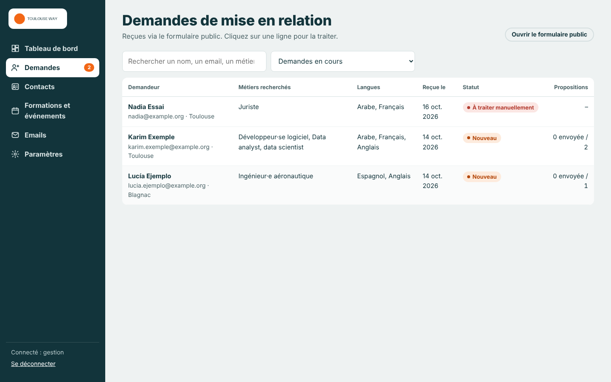

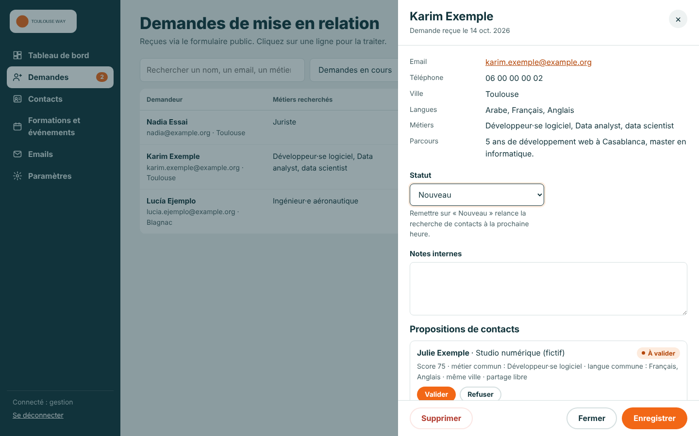

---

## 9. Manager – manage network contacts

> **As a** manager, **I want to** add and update the people in our network, including their consent to share their details.

**Steps**

1. Open **Contacts**. Search by name, company or job.
2. Click **Ajouter un contact**, or click a contact to edit it.
3. Choose the **jobs** they can help with (used for matching), the **languages** they speak and the **language of the emails** sent to them (French or English).
4. Set the two switches:
   - **Accord pour partager ses coordonnées sans le consulter**: on = details shared directly; off = consent email first (story 3).
   - **Disponible pour de nouvelles mises en relation**: off = contact paused.

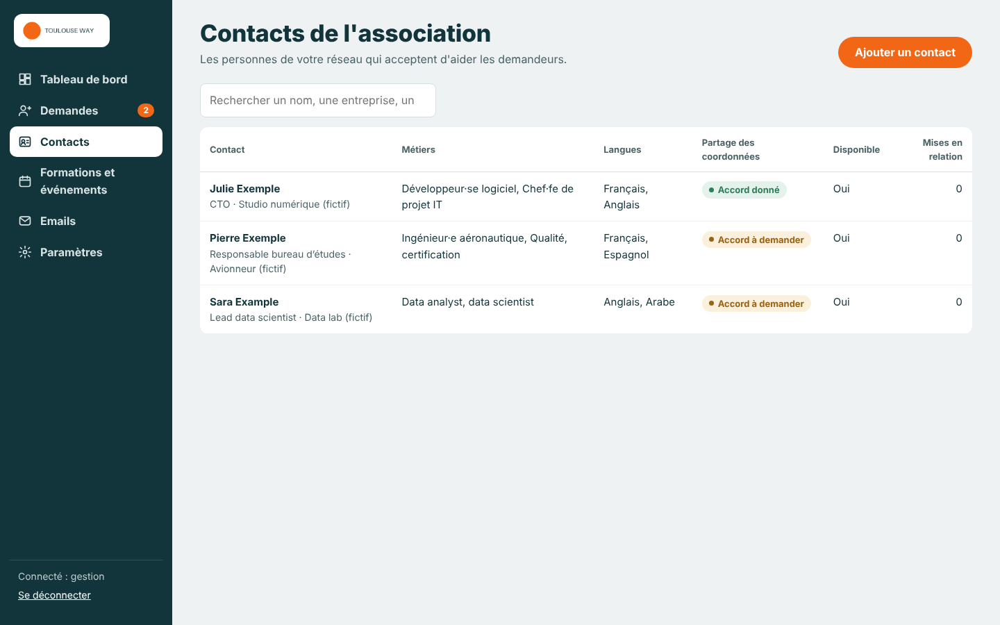

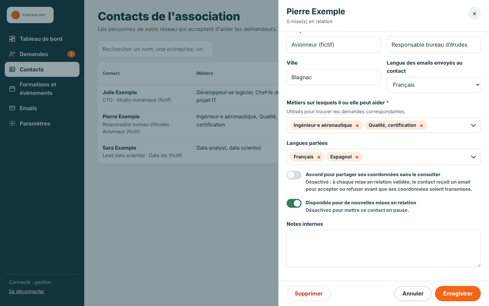

---

## 10. Manager – manage trainings, events and registrants

> **As a** manager, **I want to** create sessions, publish them and follow registrations and attendance.

**Steps**

1. Open **Formations et événements**. Filter by upcoming, past or all. Each row shows the registrations against the seats and the confirmations.
2. Click **Nouvelle session**, or click a session to edit it:
   - type (training or event), titles and descriptions in French and English;
   - date, times, venue or video link, number of seats (0 = unlimited), facilitator, practical information;
   - **Publié dans l'agenda public**: off = draft, nobody can register.
3. Copy the **direct registration link** to share the session on social media.
4. Open the **Inscrits** tab to see each participant, their language and the reminders sent. After the session, change their status (**Présent**, **Absent**, **Confirmé**…).

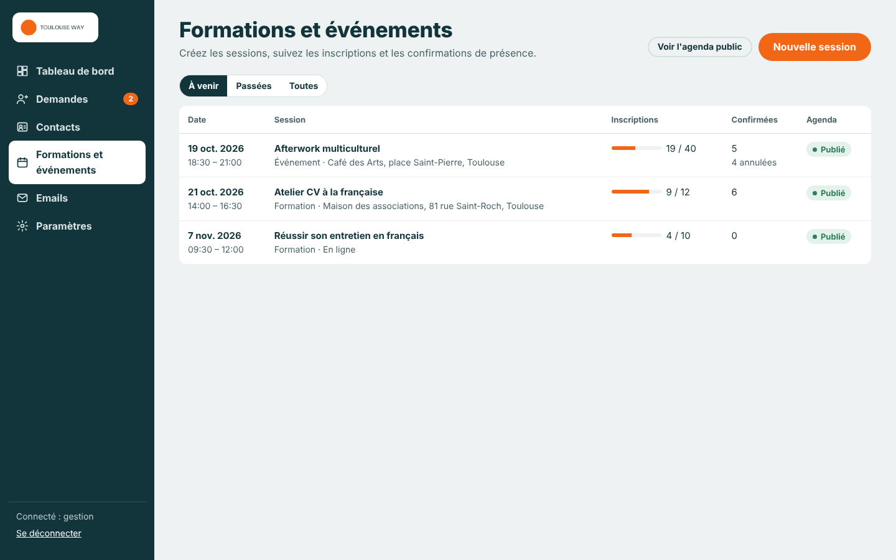

| Session details | Registrants |
| --- | --- |
| 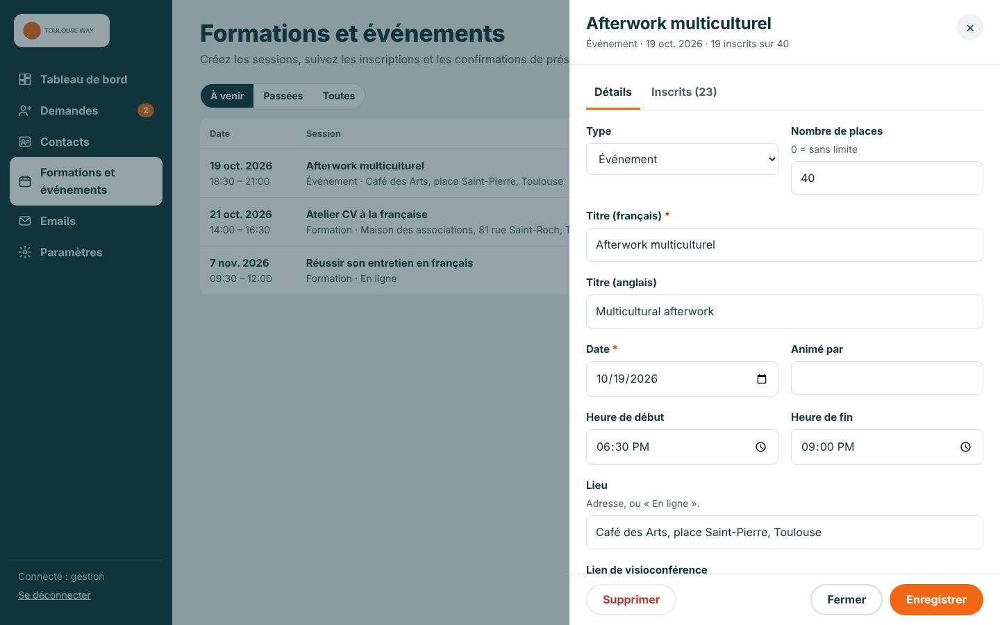 | 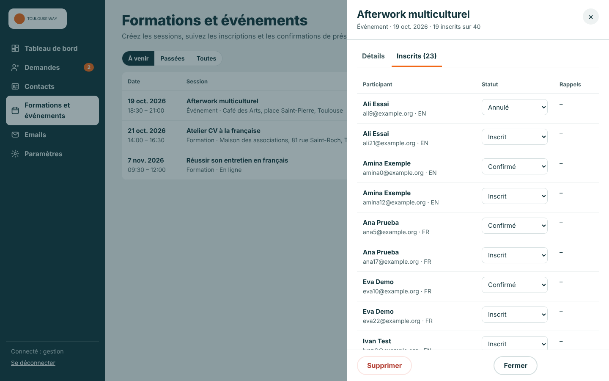 |

---

## 11. Manager – edit the emails

> **As a** manager, **I want to** change the wording of any email in any language, without touching the workflows.

**Steps**

1. Open **Emails**. The 13 emails are grouped by recipient: job seekers, contacts, participants, manager.
2. Choose an email, then a language tab.
3. Edit the subject and the text. Click a variable chip to insert it.
4. Check the **live preview**, which shows exactly what the recipient will see, then click **Enregistrer**.
5. To translate an email into a new language, use **+ Ajouter une langue**, translate the copied text and save.

**Text conventions**

| Write | Result |
| --- | --- |
| `{{prenom}}` | Recipient's first name (other variables are listed above the text) |
| `**text**` | Bold |
| A blank line | New paragraph |
| `[[Button label\|lien_confirmer]]` | A button |
| `{{details_session}}`, `{{details_contact}}`… | A formatted box, built automatically |

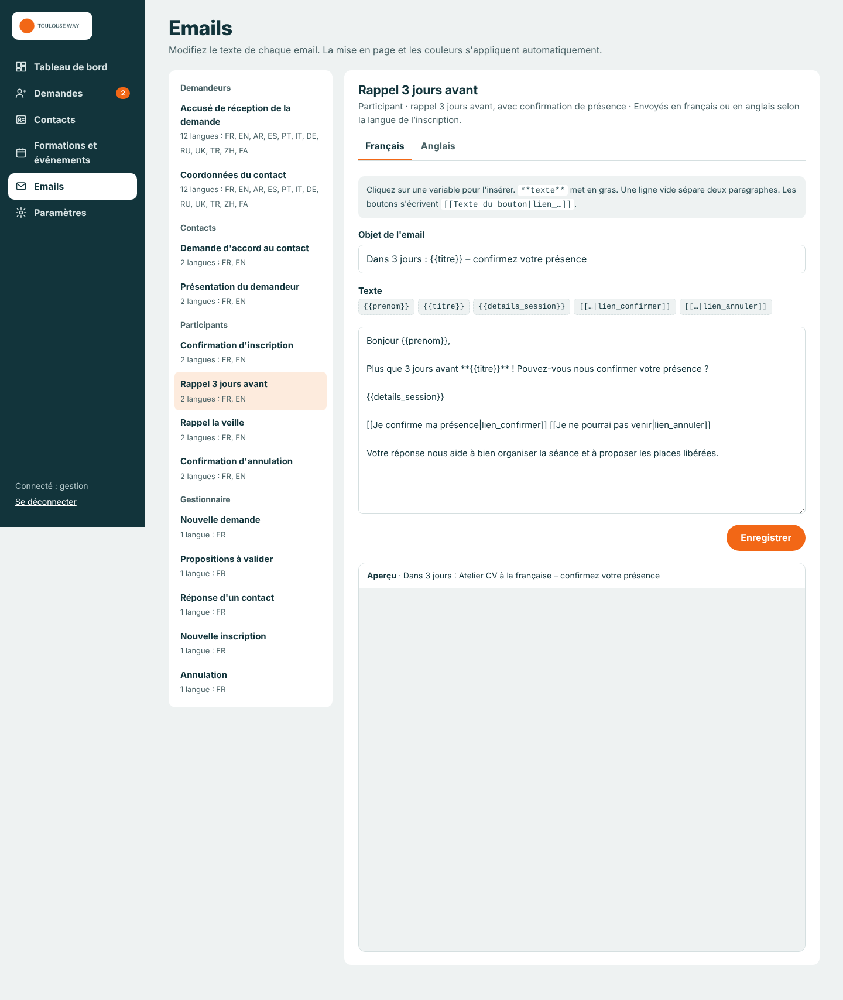

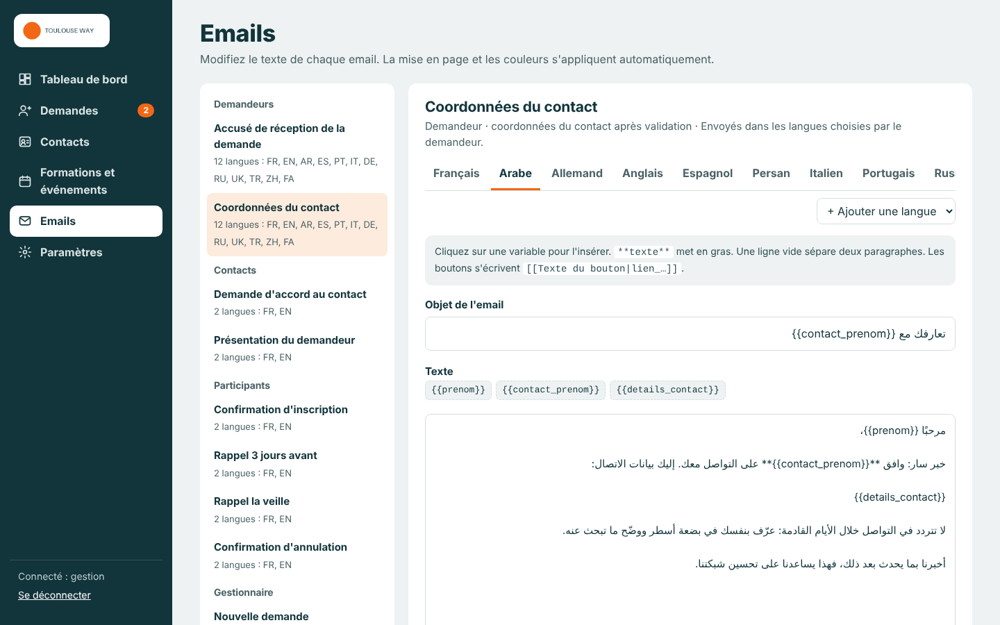

---

## 12. Manager – settings, branding and lists

> **As a** manager, **I want to** adapt the platform to the association: colours, logo, addresses, lists of jobs and languages.

The **Paramètres** screen contains:

- **Links to share**: the request form and the calendar, in French and English, plus the code to embed the calendar in the association's website.
- **Identity and settings**: name, slogan, main and text colours (with a colour picker), logo address, website, manager email, email signature and footer, n8n address, minimum matching score, maximum proposals per request. Changes apply immediately to every page and email.
- **Jobs** and **Languages**: the choices offered in the request form. Add, rename or remove entries; jobs are grouped by sector.

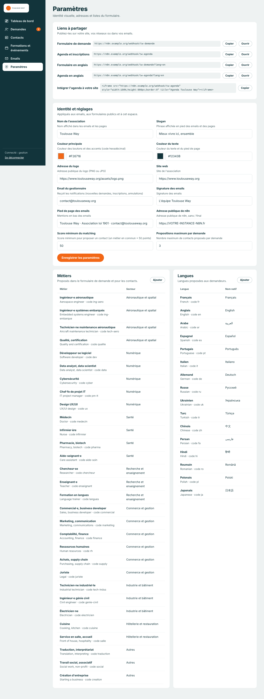

---

## 13. Everyone – use it on a phone

> **As a** user on a phone, **I want** every page to be comfortable to use on a small screen.

Every page adapts from 320 px phones to large screens:

- The forms use a single column with large touch targets.
- In the management space, the menu becomes a bottom navigation bar and tables stack as cards.
- In the email editor, the list of emails and the language tabs become drop-down lists.

| Dashboard | Emails | Request form | Registration |
| --- | --- | --- | --- |
| 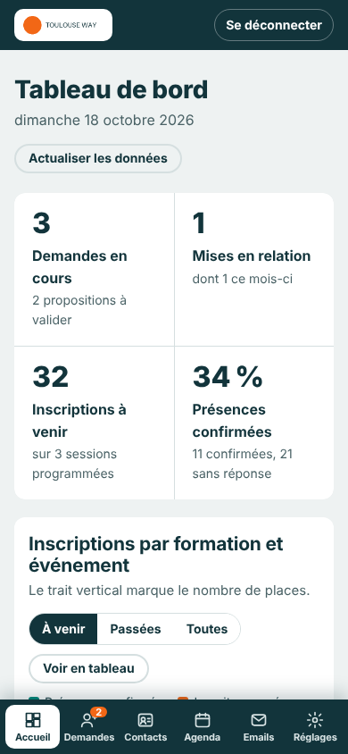 | 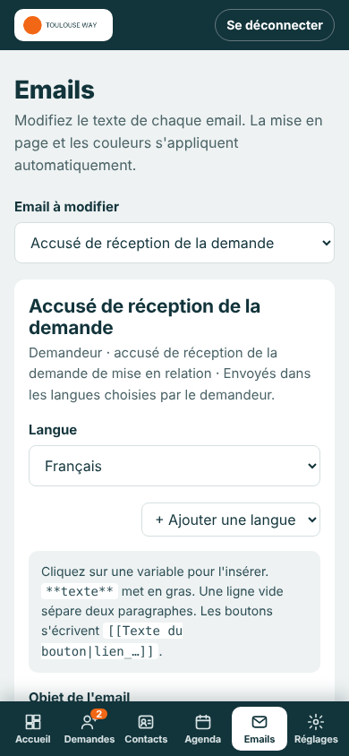 |  |  |
